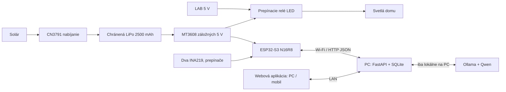

# Čo je tento projekt a ako funguje

Verzia 0.12.0-assistant, 8. 11. 2026. SOČ je funkčný nízkonapäťový model inteligentného domu s lokálnym serverom, solárnou batériou a zálohou svetiel. Dom má celé steny, strechu položenú a odnímateľnú v jednom kuse. Bez nábytku. Toto je aktuálny návrh; staršie obrázky v deliverables/ zachytávajú pôvodnú verziu.

## Rozdelenie práce

- **ESP32:** číta snímače a ovláda LED. Fyzické prepínače sa obsluhujú nezávisle od Wi-Fi/HTTP prenosu.
- **Server:** notebook, stolný PC alebo vhodný mini PC. Spúšťa FastAPI, ukladá merania do SQLite, počíta model a poskytuje webovú aplikáciu. Nemusíš kupovať cloudový server.
- **AI:** Ollama beží na tom istom PC ako backend. ESP32 nemá spúšťať jazykový model. Mobil je iba klient cez prehliadač. Asistent vie aj všeobecné otázky a môže čítacími nástrojmi zistiť konkrétnu predpoveď alebo verejné zdroje. Online zisťovanie sa vypína samostatne; podrobnosti sú v LOKALNY_ASISTENT.md.
- **Wi-Fi/router:** spája ESP, PC a mobil. Po stiahnutí závislostí a modelu samotná LAN komunikácia nepotrebuje internet. Internetové počasie a spotové ceny ho potrebujú samostatne.

## Meranie a model sú rozlíšené

Dva INA219 merajú malý panel a čistý prúd/napätie článku. Kladný batériový prúd znamená nabíjanie, záporný vybíjanie. Percentá sú hrubý odhad zo všeobecnej napäťovej krivky LiPo; nie je to fuel gauge ani test skutočnej kapacity. Pri nabíjaní môže odhad nadhodnocovať a pri záťaži podhodnocovať. Hodnota 2 500 mAh je údaj zo štítku. Skutočná využiteľná kapacita vyžaduje kontrolované vybíjanie s integráciou prúdu a odpojením na stanovenej hranici.

Veľké výkony domu v kW, import/export a virtuálna domáca batéria sú výpočtový model. Malý článok fyzicky napája LED a ESP, nie kilowattový dom. Fyzické svetlá sa ovládajú dvoma prepínačmi A/B na vyvýšenom paneli vľavo vpredu; 3D model ukazuje ich hlásený stav. Spotreba jednotlivých miestností sa nemerajú.

## Záloha svetiel

Relé REL300 má VCC/JD-VCC z hlavného 5 V zdroja, IN pevne na GND. NO je hlavný zdroj, NC meničových 5 V, COM LED napájanie. Výpadok prepne kontakt hardvérovo, aj bez servera. Prepnutie mechanického relé má krátku prestávku; svetlá môžu bliknúť. Stav kontaktov sa nemeria, napájacia vetva v aplikácii sa odvodzuje zo snímania hlavného zdroja.

ESP je stále na MT3608, aby zostalo dostupné pri výpadku. Preto odoberá z batérie aj pri dostupnom hlavnom zdroji. Solár pod izbovou lampou nemusí pokryť ani tento odber. CN3791 nemá oddelený systémový LOAD výstup: pri trvalej záťaži nemusí korektne ukončiť plné nabíjanie. Na úplné prednabitie odpoj MT3608 a všetky záťaže servisnou prepojkou; potom použi CN3791 zo zdroja so solárom odpojeným. Nejde o návrh bezúdržbovej domácej UPS; je to prezentačný model s týmto známym obmedzením.

Notebook a router neodpájaj pri ukážke vypnutia laboratórnej vetvy. Keď sa článok vybije až po ochranné odpojenie, vypnú sa ESP aj LED a aplikácia správne ukáže offline stav.

## Strecha s panelom

Panel je priamo na prednej strešnej rovine so sklonom 35°. Celá strecha vrátane panela a líšt sa zdvihne ako jeden kus. Pred úplným odložením sa rozpojí označený konektor. Všetky LED, ESP a batéria ostávajú v pevnej časti domu. Rozmer podstavy zostáva 600 × 450 mm.

## AI a server – konkrétne spustenie

1. Na PC nainštaluj Python a spusti `start.cmd`. Web je `http://127.0.0.1:8765`.
2. Nainštaluj Ollamu z https://ollama.com/download a spusti `ollama pull qwen3:0.6b`.
3. V aplikácii Nastavenia → Asistent povoľ asistenta a stlač overenie pripojenia. Pre lepší chat pri dostatočnej pamäti použi `qwen3:4b-instruct-2507-q4_K_M`; predvolené 0.6B je úsporné, má slabšiu kvalitu slovenčiny.
4. Ollama počúva iba na lokálnom PC. Backend ju volá na `127.0.0.1:11434`; tento port netreba sprístupňovať mobilu ani internetu.
5. PC a ESP sú v rovnakej LAN. PC nech má rezervovanú IP adresu v routeri, napr. 192.168.1.100. V `secrets.h` je URL `http://192.168.1.100:8765/api/device/telemetry`.
6. Kľúč z `data/device_key.txt` skopíruj do `DEVICE_KEY`. Nezverejňuj ho v GitHube. Nový `secrets.h` zostáva ignorovaný Gitom.
7. Na mobile otvor LAN adresu PC s portom 8765. PC musí bežať, ESP vyžaduje 2,4 GHz Wi-Fi bez izolácie klientov.

AI dostáva vybrané systémové fakty, dostupné merania a pôvod údajov. Vysvetľuje stav a môže navrhnúť povolené nastavenia, ktoré používateľ potvrdí. Nie je to autonómna elektroinštalácia ani bezpečnostný regulátor. Číselné predikcie počíta Python, nie LLM. Pri nedostupnej Ollame meranie, 3D model a fyzické prepínače fungujú ďalej.

## Súbory na stavbu

- `model-domu/3d/dom.blend`, `dom.glb`: skutočný rozmerový 3D model.
- `model-domu/STAVEBNY-NAVOD.pdf`: A3 prehľad na montáž.
- `model-domu/rezaci-plan.csv`, `dlzky-vodicov.csv`: rozmery a predstrihy.
- `model-domu/vykresy/`: SVG šablóny 1:1 a pôdorys.
- `docs/KOMPONENTY.md`: jednotný kusovník a známe otvorené položky.
- `docs/ZAPOJENIE.md`: pinová tabuľka, vodiče, kontrolné merania a skúšky.
- `firmware/esp32-s3/`: aktuálny firmvér s lokálnou obsluhou LED a dvoma INA219.

Návod BENCHTWIN-NAVOD.txt a kompatibilný skúšobný sketch sú v samostatnom priečinku SOC-simulacia vedľa projektu. BenchTwin nepodporuje FreeRTOS úlohy produkčného firmvéru; samostatný sketch overuje ovládanie a elektrické zapojenie podľa návodu.
